# Nuzhat al-Naẓar, visualised

A visual guide to Ibn Ḥajar al-ʿAsqalānī's *Nuzhat al-Naẓar*, his short book on the hadith sciences. The book sorts every report by how it reached us, whether it is accepted or rejected, where its chain ends, how it was passed on and who its narrators were. This site draws that structure: the eight divisions orbit the Prophet ﷺ as planets, narrators are figures whose scroll and seal show how far they can be trusted, and every term links to a short paraphrase with its section number.

Live site: <https://adehad.github.io/hadith-science/>

<picture>
  <source media="(prefers-color-scheme: dark)" srcset="docs/screenshots/map-desktop-dark.png">
  <source media="(prefers-color-scheme: light)" srcset="docs/screenshots/map-desktop-light.png">
  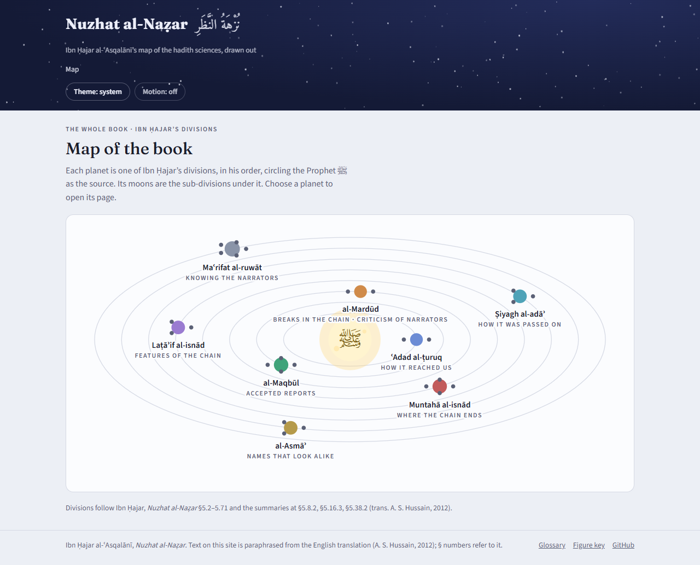
</picture>

## What's covered so far

- **The map** of all eight divisions. On portrait phones it becomes a nested list.
- **A page for each division** with its sub-divisions and terms.
- **The figure key** (`/narrators/`), showing how a narrator figure is read.
- **The glossary** (`/terms/`): all 169 terms, each with a paraphrased definition and its § reference. It can be filtered, and you can search without diacritics.
- **Share links:** `/t/<term>/`, `?<term>` and `?t=<term>` all go to the term. Unknown terms open a glossary search.
- Light and dark themes, and full support for reduced motion, plus a **Motion** switch in the header that stops every animation.
- Installable as an app, and readable offline after the first visit.

- **Twenty-one scenes** (below), each one diagram whose terms open a popover and have their own share link.

Terms without a scene yet are marked "scene coming soon" in the glossary. Later phases draw the rest, one division at a time.

| | Light | Dark |
|---|---|---|
| Figure key | 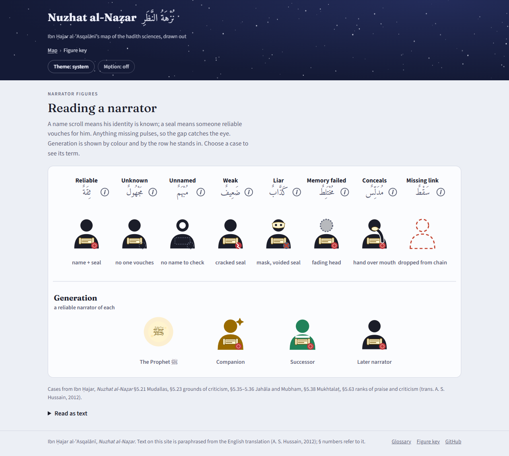 | 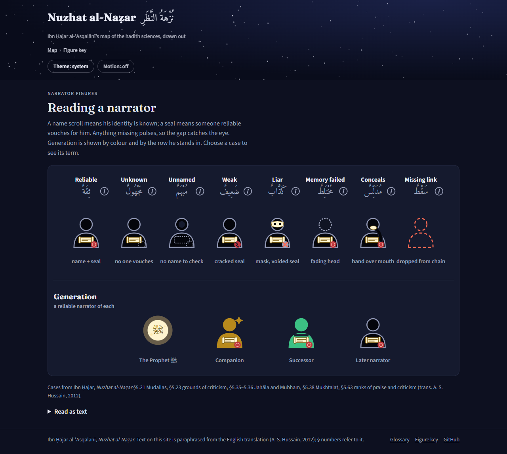 |
| Phone | 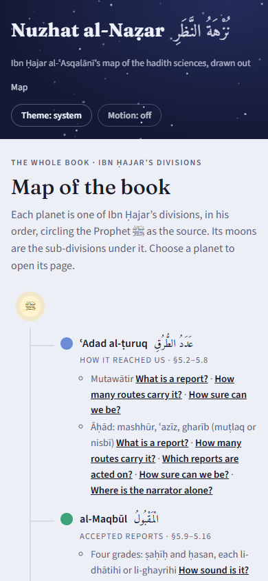 | 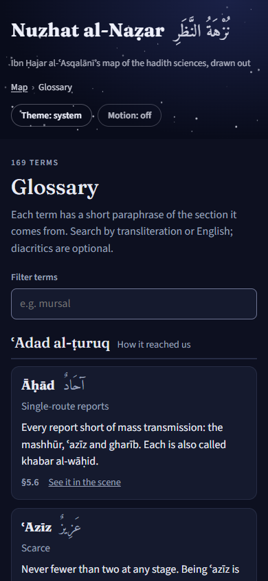 |

## Scenes

| Scene | Page | Terms |
|---|---|---|
| **ʿAdad al-ṭuruq** (how a report reached us) | | |
| What is a report? | `/adad-al-turuq/report/` | khabar, ḥadīth, isnād, matn |
| How many routes carry it? | `/adad-al-turuq/routes/` | mutawātir, mashhūr, ʿazīz, gharīb |
| Which reports are acted on? | `/adad-al-turuq/sorting/` | āḥād, mustafīḍ, maqbūl, mardūd |
| How sure can we be? | `/adad-al-turuq/knowledge/` | al-ʿilm al-yaqīnī, al-ʿilm al-naẓarī, al-khabar al-muḥtaff bi-l-qarāʾin |
| Where is the narrator alone? | `/adad-al-turuq/lone/` | gharīb muṭlaq, fard, gharīb nisbī |
| **al-Maqbūl** (accepted reports) | | |
| How sound is it? | `/al-maqbul/grades/` | ṣaḥīḥ and ḥasan, in themselves and by others; ʿadl, ḍabṭ and ittiṣāl; the soundest chains; ḥasan ṣaḥīḥ |
| Who outweighs whom? | `/al-maqbul/opposition/` | ziyādat al-thiqa, shādhdh and maḥfūẓ, munkar and maʿrūf |
| Does anyone else carry it? | `/al-maqbul/support/` | iʿtibār, mutābaʿa (full and partial), mutābiʿ, shāhid |
| Can both be acted on? | `/al-maqbul/acted-on/` | muḥkam, mukhtalif al-ḥadīth, naskh, nāsikh and mansūkh, tarjīḥ, tawaqquf |
| **al-Mardūd** (rejected reports) | | |
| Why is a report rejected? | `/al-mardud/causes/` | saqṭ, ṭaʿn |
| Where does the chain break? | `/al-mardud/breaks/` | mursal, muʿallaq, muʿḍal, munqaṭiʿ |
| Did he hear it from him? | `/al-mardud/hidden/` | mudallas, mudallis, mursal khafī |
| Did he lie? | `/al-mardud/lying/` | kadhib, tuhma bi-l-kadhib, mawḍūʿ, matrūk |
| Did he keep it right? | `/al-mardud/slips/` | fuḥsh al-ghalaṭ, ghafla, wahm, muʿallal, sūʾ al-ḥifẓ, mukhtaliṭ |
| What changed in the telling? | `/al-mardud/changes/` | mukhālafa, mudraj (in the chain and the text), maqlūb, al-mazīd fī muttaṣil al-asānīd, muḍṭarib, muṣaḥḥaf, muḥarraf |
| May the words be changed? | `/al-mardud/wording/` | ikhtiṣār al-ḥadīth, al-riwāya bi-l-maʿnā, gharīb al-ḥadīth |
| Why is he unknown? | `/al-mardud/identity/` | jahāla, al-wuḥdān |
| Who is this narrator? | `/al-mardud/unknown/` | mubham, majhūl, majhūl al-ʿayn, mastūr |
| Does his belief count against him? | `/al-mardud/innovation/` | fisq, bidʿa |
| **Other divisions** | | |
| How was it received? | `/siyagh-al-ada/delivery/` | the eight ranks of delivery words, and the weaker ways below them |
| Who is who? | `/al-asma/names/` | muttafiq wa-muftariq, muʾtalif wa-mukhtalif, mutashābih |

Figure scenes can show a key under the diagram (**Key**) or write each narrator's kind beside the figure (**Labels**), and the choice is remembered. Where the book gives more than one position, **Other views** switches the diagram to it and keeps the view in the link (`?view=`). On a portrait phone a wide diagram becomes a swipe carousel, one panel at a time.

<picture>
  <source media="(prefers-color-scheme: dark)" srcset="docs/screenshots/breaks-desktop-dark.png">
  <source media="(prefers-color-scheme: light)" srcset="docs/screenshots/breaks-desktop-light.png">
  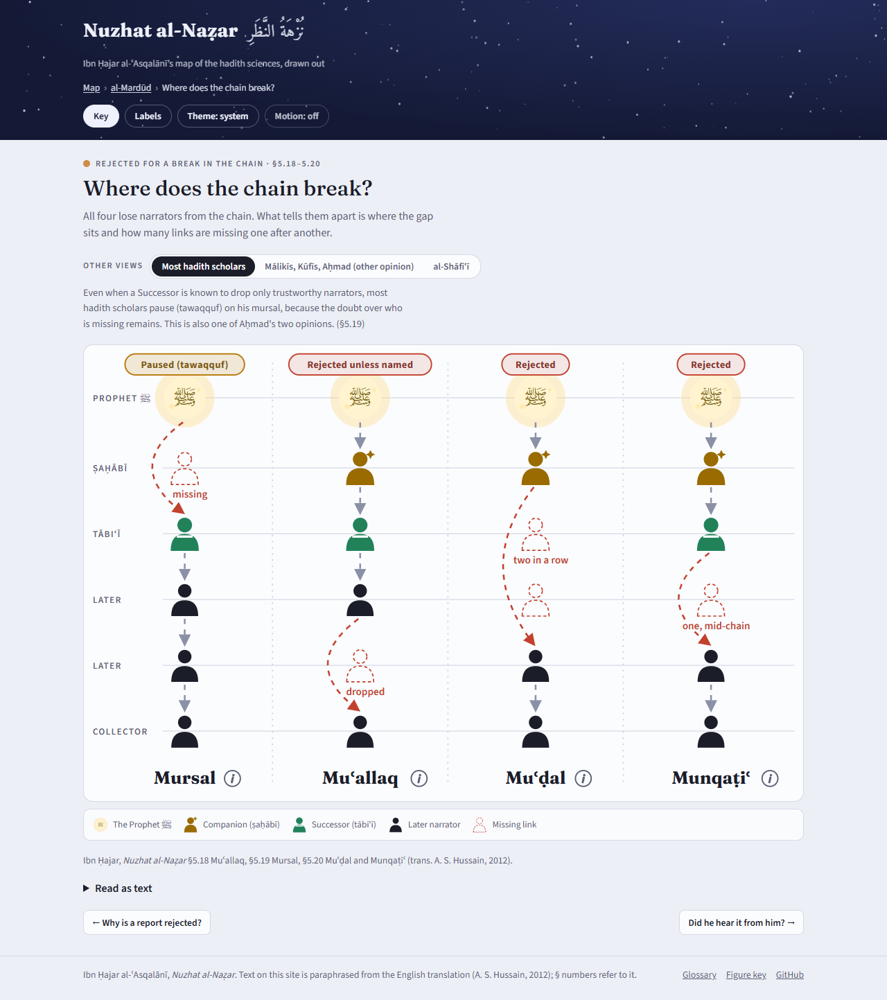
</picture>

| | Light | Dark |
|---|---|---|
| Can both be acted on? | 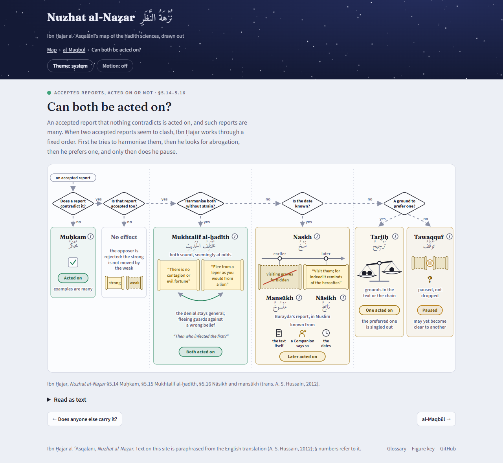 | 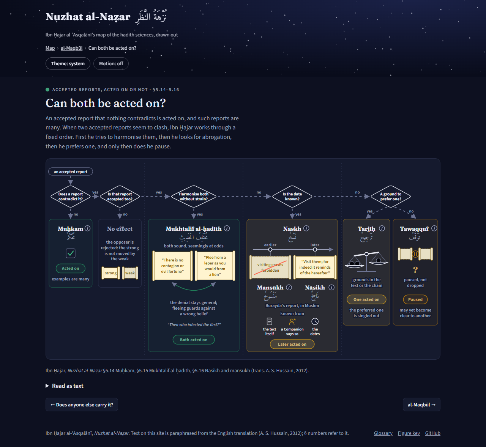 |
| Where is the narrator alone? | 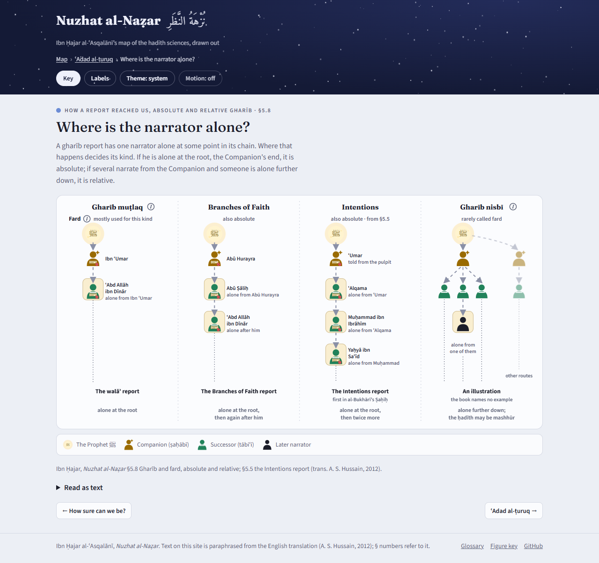 | 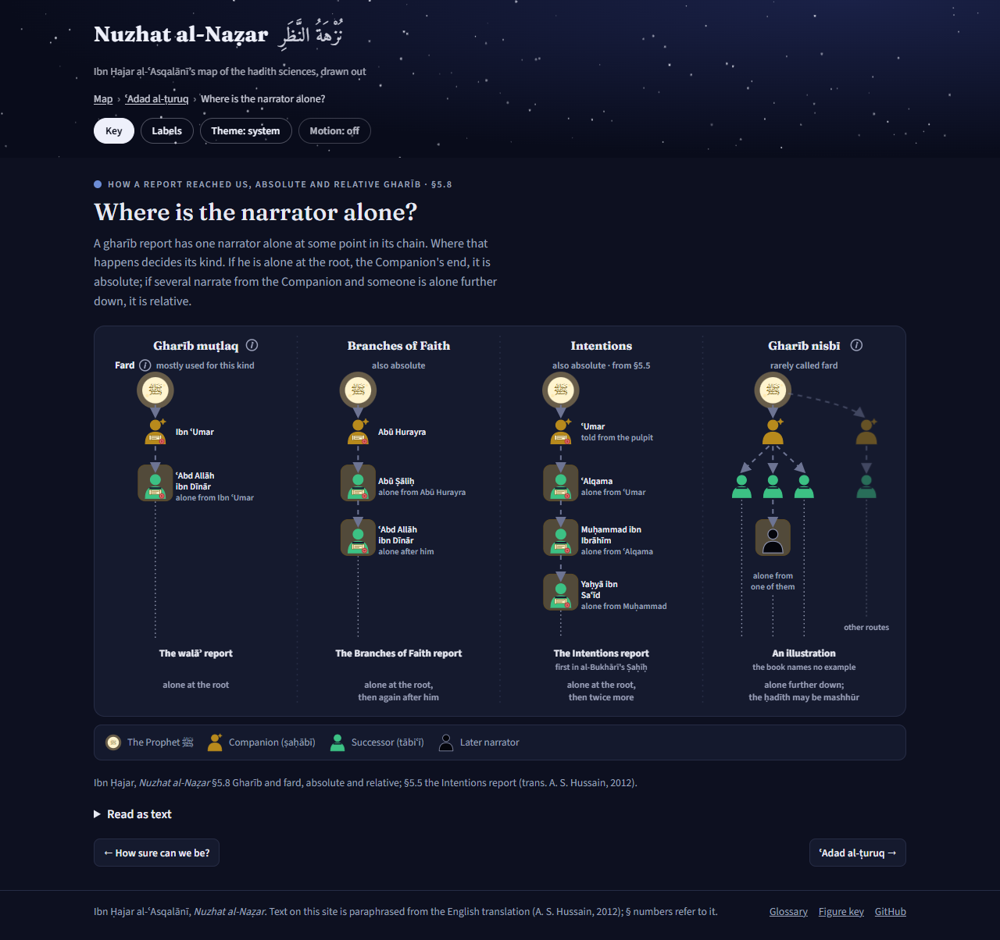 |
| How was it received? | 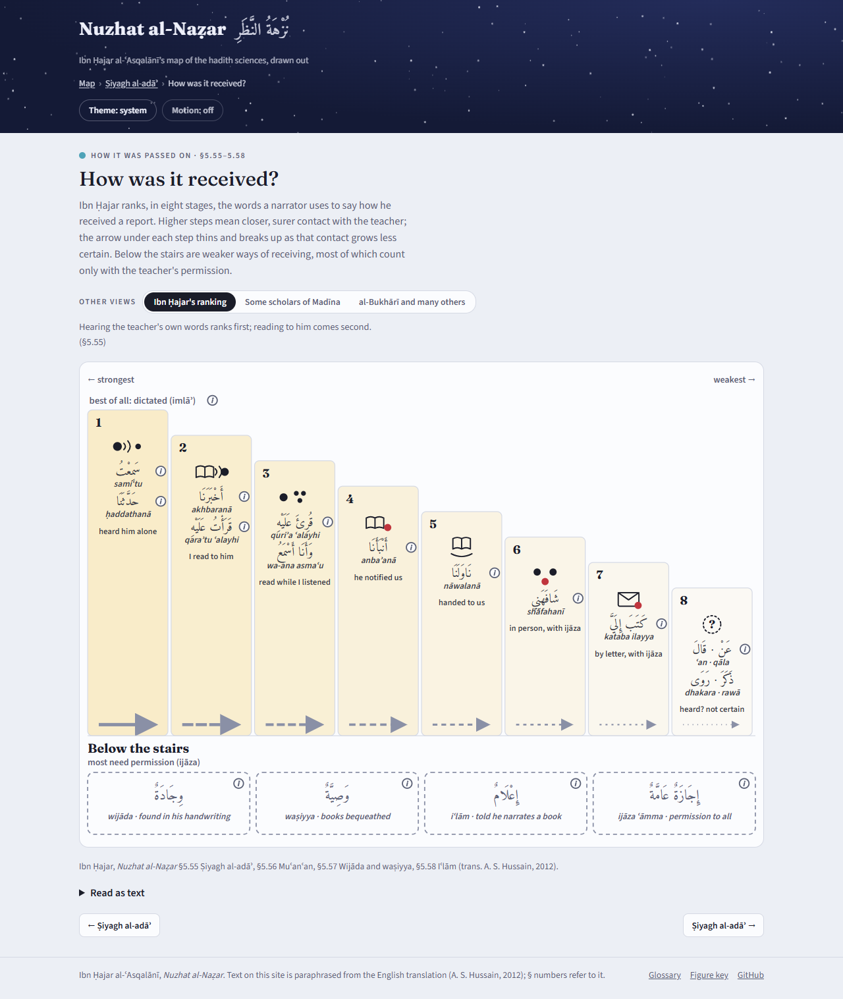 | 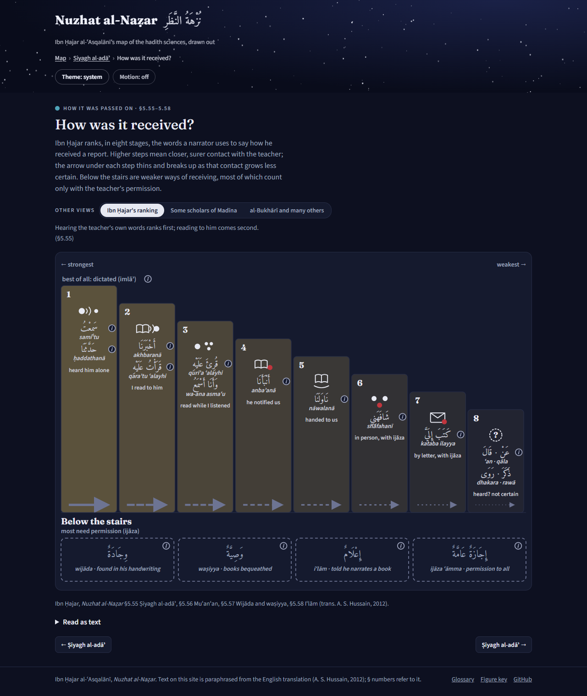 |
| Why is a report rejected? | 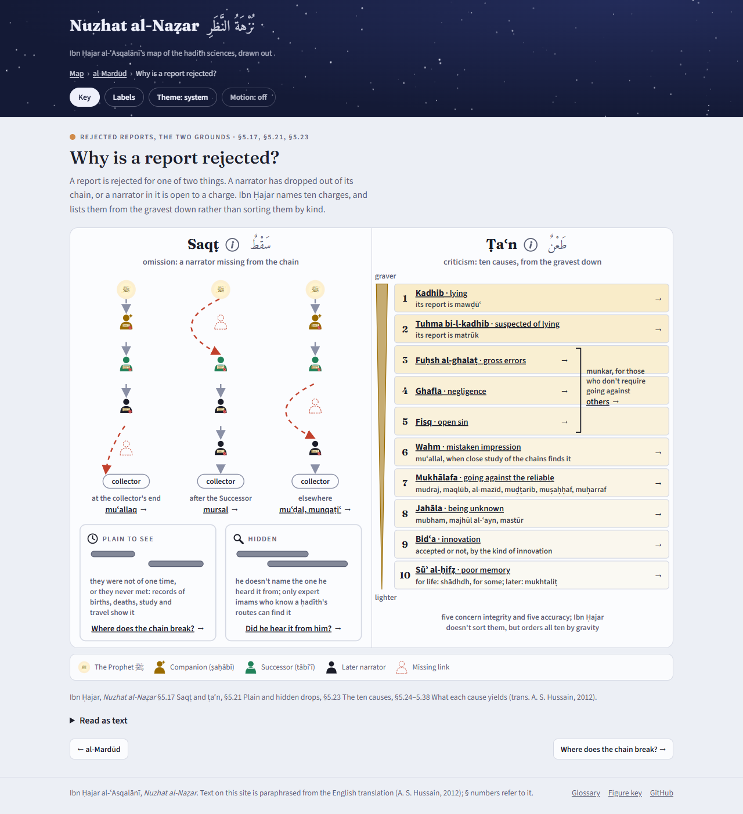 | 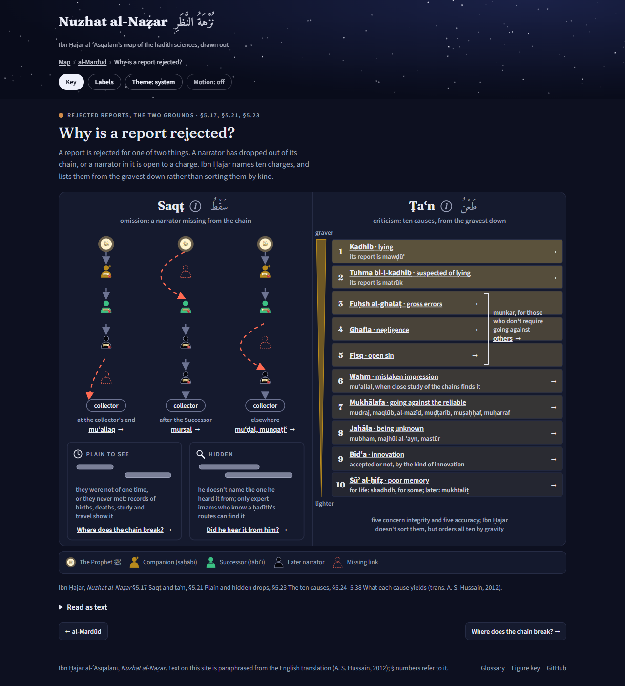 |
| Phone | 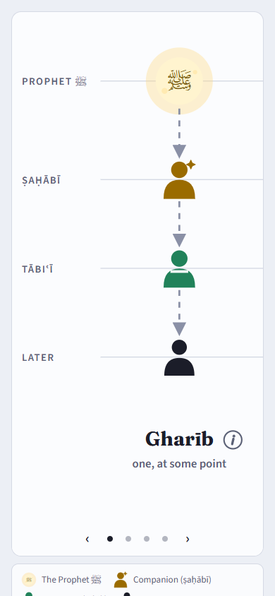 | 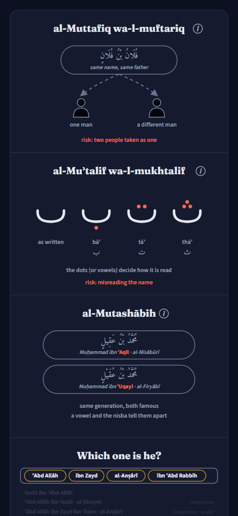 |

## Source and copyright

The site follows the English translation of the *Nuzhah* in A. S. Hussain's 2012 thesis. That translation may not be redistributed, so:

- All text on the site is our own paraphrase. Every claim carries the § number it comes from, such as "§5.55".
- Nothing from the translation is reproduced beyond a few words of Arabic terminology.
- The thesis and anything extracted from it stay out of the repository, in the git-ignored `source/` folder. A pre-commit hook and CI both fail if any of it is committed.

Possible slips in the translation are listed in `notes/translation-queries.md`.

## Development

This project uses [Bun](https://bun.sh) for packages and scripts.

```sh
bun install
bun run dev           # local dev server
bun run build         # static build into dist/, then the offline service worker
bun run preview       # serve dist/
bun run check         # astro check (types)
bun run test          # unit tests (Vitest)
bun run test:e2e      # end-to-end tests (Playwright); needs a build first
bun run screenshots   # regenerate docs/screenshots/; needs a build first
bun run test:base     # build under /hadith-science/ and check every link keeps the base
```

The end-to-end tests run against `bun run preview` on port 4321. If something else is already using that port, set `E2E_PORT` to use a different one. Locally, Playwright drives the system Microsoft Edge. CI installs Playwright's own Chromium instead (`bunx playwright install --with-deps chromium`).

The app icons in `public/icons/` are generated from `public/icons/icon.svg` (a copy of `public/favicon.svg`) by `bunx pwa-assets-generator`; regenerate and commit them if the icon changes.

Pre-commit hooks are run by [prek](https://github.com/j178/prek) (`prek install`). They check whitespace, YAML, spelling, Arabic presentation forms and the source guard, and run the unit tests.

## Deployment

- **Production:** GitHub Pages, deployed by `.github/workflows/ci.yml` on every push to `main`. The workflow sets `SITE` and `BASE` from `actions/configure-pages`, so the site is served under `/hadith-science/`.
- **Branch previews:** Cloudflare Workers Builds, configured by `wrangler.toml`. Previews serve the site at `/`. To set them up once in the Cloudflare dashboard:
  1. Connect this repository to Workers Builds.
  2. Name the Worker **`hadith-science`**. It must match `name` in `wrangler.toml`.
  3. Set the build command to **`bun install && bun run build`**.
  4. Keep the default deploy command for non-production branches (`bunx wrangler versions upload`). Every branch then gets a preview URL.

## Licence

To be decided.
